<div align="center">


# tbo-tracker

**Обслуживание БПЛА по фактической наработке**

Сервис поэкземплярного учёта ресурса беспилотников и их заменяемых узлов.<br>
Часы налёта и циклы идут за узлом при любой перестановке, сроки ТО и допуск к полёту рассчитываются автоматически.

[](app/config.py)
[](requirements.txt)
[](docs/ARCHITECTURE.md)
[](docs/DEPLOY.md)
[](docs/DRONE.md)
[](docs/RASPBERRY_PI.md)
[](docs/DEPLOY.md)
[](LICENSE)

[Возможности](#возможности) · [Экраны](#экраны) · [**Быстрый старт**](#быстрый-старт) · [Полёт на борту](#полёт-на-реальном-борту) · [Как устроено](#как-устроено) · [Испытания](#испытания) · [Документация](#документация)

</div>

<p align="center">
  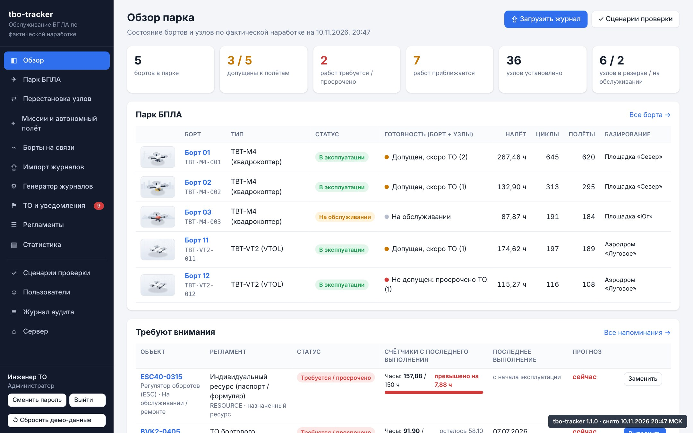
  <br>
  <sub>«Обзор»: допуск каждого борта с учётом всех установленных узлов и работы, требующие внимания. Данные на экране случайно сгенерированы (демо-режим), версия 1.1.0.</sub>
</p>

| | |
|---|---|
| **Кейс** | «Обслуживание БПЛА по фактической наработке» · чемпионат «Хайтек: навыки будущего» 2026, компетенция «Летающая робототехника» |
| **Заказчик кейса** | ООО «СПУТНИК-РЕД», КБ «СОКОЛ», г. Рязань |
| **Команда** | НИЯУ МИФИ, Москва – [состав и роли](#команда) |
| **Репозиторий** | <https://github.com/DanilTeplo/tbo-tracker> |
| **Паспорт проекта** | [PDF](docs/passport/tbo-tracker-passport.pdf) · [DOCX](docs/passport/tbo-tracker-passport.docx) · [кратко](docs/PASSPORT.md) |

> [!IMPORTANT]
> Данные в README и документации случайно сгенерированы: демо-парк на экранных формах, замер против учёта
> по формуляру, характеристики Х1–Х7. Реальные испытания – около 50 запусков на одном дроне.

## О проекте

**Проблема.** Узлы – полётные контроллеры, инерциальные модули, регуляторы оборотов, бортовые вычислители – переставляют
с борта на борт, а формуляр ведётся по борту. Часы, наработанные узлом раньше, в формуляр нового борта не попадают,
и сроки ТО пропускаются.

**Решение.** tbo-tracker ведёт наработку – часы налёта и циклы – каждого борта и каждого экземпляра узла по фактическим
полётам, рассчитывает остаточный ресурс и сроки работ, допускает или не допускает борт к полёту и напоминает о работах.

<p align="center">
  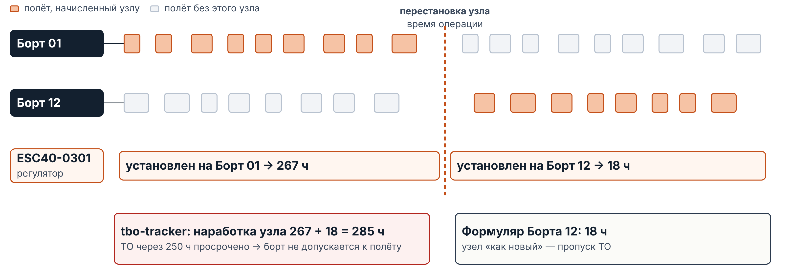
</p>

Замер на случайно сгенерированных данных: модель парка – 6 бортов, 90 дней, случайные замены и перестановки
узлов, среднее по 10 повторам ([протокол испытаний](docs/protocols/protocol-2026-11-09.md)):

| Показатель | Учёт по формуляру борта | tbo-tracker |
|---|:-:|:-:|
| Наработка узлов, которой нет в учёте | ≈ 1 694 ч | **0** (отклонение от эталона ≤ 0,0033 ч) |
| Просроченные работы, не видимые в учёте | ≈ 6,3 | **0** |

**Для кого:** инженер по ТО эксплуатанта гражданских БПЛА (парк 5–50 бортов), сервисный центр, служба эксплуатации
предприятия.

**Состав:** сервер tbo-tracker на Raspberry Pi 5 или в Docker · веб-интерфейс, который не нужно устанавливать ·
бортовой агент `tbo-agent` для квадрокоптера Skyris Technic 6S (Orange Pi 5 Pro + PX4). Работает без интернета,
в закрытом контуре. Задуман как будущий модуль «Виртуального гаража автономных систем».

## Возможности

Соответствие 10 критериям кейса. Реализация, сценарий проверки и автотесты по каждому – в [CRITERIA.md](docs/CRITERIA.md).

| № | Требование кейса | Как реализовано | Где в интерфейсе |
|:-:|---|---|---|
| 1 | Автономный полёт по заданному маршруту | редактор миссии на карте, курс дрона, предполётная проверка допуска, симулятор автопилота, экспорт и импорт QGroundControl `.plan` / `.waypoints`; полёт на реальном борту через агент `tbo-agent` – по GPS и в помещении | «Миссии и автономный полёт», «Борты на связи» |
| 2 | Электронные паспорта узлов | UID, технические характеристики, установленный ресурс, наработка с начала эксплуатации и остаточный ресурс, история установок и обслуживания | карточка узла → «Электронный паспорт» |
| 3 | Мониторинг падений и столкновений | детектор по акселерометру: падение – невесомость < 0,35 g от 0,2 с, затем удар ≥ 3 g; столкновение – удар ≥ 4 g; касание при посадке не считается. Счётчики, внеплановый осмотр, запрет вылета до осмотра | карточка борта → «Датчики», «ТО и уведомления» |
| 4 | Учёт фактической наработки | часы налёта и циклы начисляются борту и каждому узлу, стоявшему на нём в момент взлёта; журналы JSON, CSV, Excel, PDF и от бортового агента; защита от повторов: хеш файла, номер полёта, пересечение по времени | «Импорт журналов», «Парк БПЛА» |
| 5 | Журналы установок, снятий и перестановок из Excel и PDF | строки применяются в хронологическом порядке с теми же проверками, что и ручные операции; ошибочная строка отклоняется с причиной; PDF-копия журнала не задваивает операции; шаблон `.xlsx` | «Импорт журналов» |
| 6 | Наработка и остаточный ресурс с учётом истории | наработка вычисляется по интервалам установки: часы идут за узлом при перестановке, поздний журнал и операции задним числом пересчитываются сами | карточка узла, «Перестановка узлов» |
| 7 | Регламентное ТО и автоматические уведомления | регламенты по часам, циклам, календарю и событиям датчиков, назначенный ресурс; выполнение работы обнуляет только свой интервал; уведомления «предельный ресурс», «просрочено», «приближается» – в интерфейсе, в браузере, в Telegram и на webhook | «Регламенты», «ТО и уведомления» |
| 8 | Веб-интерфейс | карточки бортов и узлов, конфигурация борта, резерв и ремонт, история замен, допуск к полёту, предстоящие работы с прогнозом даты | все разделы |
| 9 | Демонстрация на тестовых данных | случайно сгенерированный демо-парк и 10 сценариев приёмки с таблицей «до / после» | «Сценарии проверки» |
| 10 | Перемещение узлов между карточками с пересчётом паспорта | перетаскивание между бортами, резервом и ремонтом, подсветка совместимых позиций, таблица «было → стало» | «Перестановка узлов» |

**Кроме того:**

- **свои типы бортов и узлов** с посадочными местами, обязательными и необязательными, – «Узлы и склад» → «Свои типы узлов»;
- **ручная запись** полётов и наработки узла вне борта: стенд, испытания, перенос из формуляра;
- **индивидуальный ресурс** (максимальный износ) конкретного борта или узла – кнопка «Ресурс»;
- **генератор журналов** эксплуатации – в интерфейсе и в командной строке `python -m app.loggen`;
- **фото бортов** – 5 иллюстраций по отраслям и свой пул фото (JPEG, PNG, WebP);
- **«Статистика»** – налёт парка по месяцам, скрытая наработка, предотвращённые пропуски ТО, калькулятор эффекта в рублях;
- **«Сервер»** – состояние Raspberry Pi, рассылка уведомлений в Telegram и на webhook, резервные копии; утилита `tbo-ctl` по SSH;
- **учётные записи и роли** – администратор, инженер, наблюдатель; журнал аудита;
- **REST API** с описанием OpenAPI – для интеграции с ERP, 1С и «Виртуальным гаражом».

## Экраны

Экранные формы сняты в демо-режиме на случайно сгенерированных данных.

> **Навигация.** Меню: «Обзор», «Парк БПЛА», «Перестановка узлов» (переключатель «Перестановка / Узлы и склад»
> вверху страницы), «Миссии и автономный полёт», «Борты на связи», «Импорт журналов», «Генератор журналов»,
> «ТО и уведомления» (вкладки «Уведомления», «Все сроки ТО», «Журнал выполненных работ»), «Регламенты», «Статистика»,
> «Сценарии проверки»; администратору – ещё «Пользователи», «Журнал аудита», «Сервер».
> Справочник «Типы бортов и узлов» открывается кнопкой «Свои типы узлов» в «Узлах и складе».

<table>
  <tr>
    <td width="50%" valign="top">
      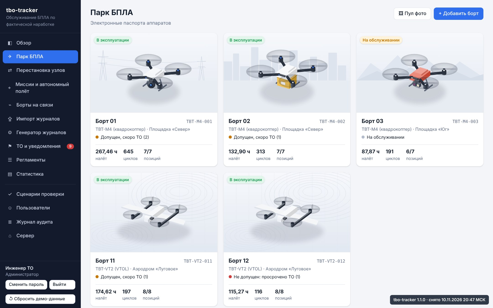
      <p><b>«Парк БПЛА»</b> – электронные паспорта бортов: фото, статус, допуск, налёт, циклы, комплектность</p>
    </td>
    <td width="50%" valign="top">
      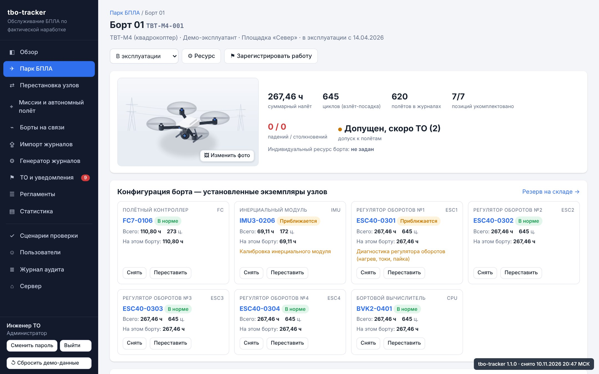
      <p><b>Карточка борта</b> – конфигурация: установленные экземпляры узлов, их наработка всего и на этом борту, ближайшие работы</p>
    </td>
  </tr>
  <tr>
    <td width="50%" valign="top">
      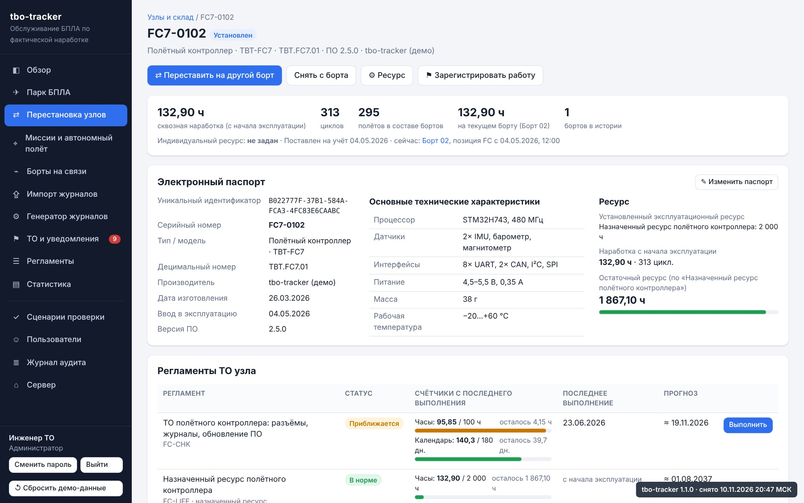
      <p><b>Электронный паспорт узла</b> – UID, характеристики, установленный и остаточный ресурс, регламенты ТО узла</p>
    </td>
    <td width="50%" valign="top">
      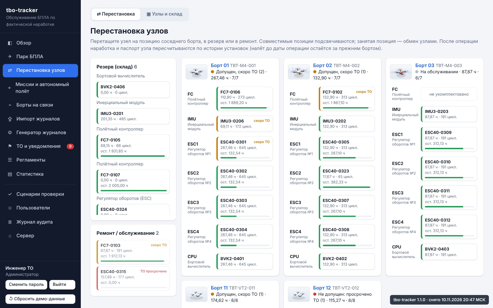
      <p><b>«Перестановка узлов»</b> – перетаскивание между бортами, резервом и ремонтом с пересчётом паспорта</p>
    </td>
  </tr>
  <tr>
    <td width="50%" valign="top">
      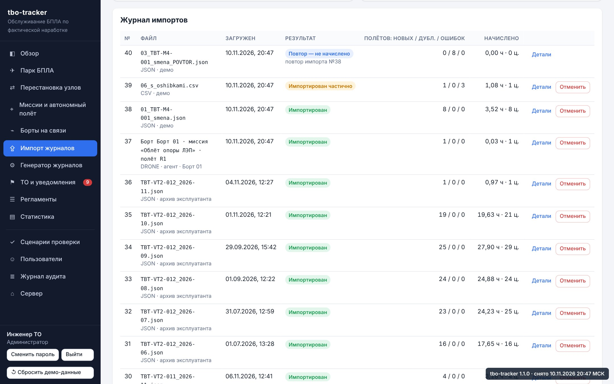
      <p><b>«Импорт журналов»</b> – повтор не начисляется, ошибочные строки отклоняются, любой импорт можно отменить</p>
    </td>
    <td width="50%" valign="top">
      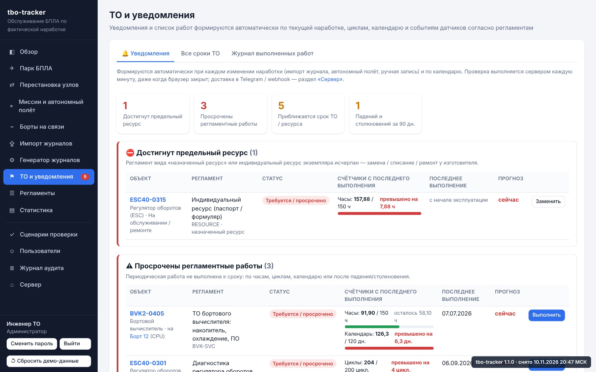
      <p><b>«ТО и уведомления»</b> – предельный ресурс, просроченные и приближающиеся работы, падения и столкновения</p>
    </td>
  </tr>
  <tr>
    <td width="50%" valign="top">
      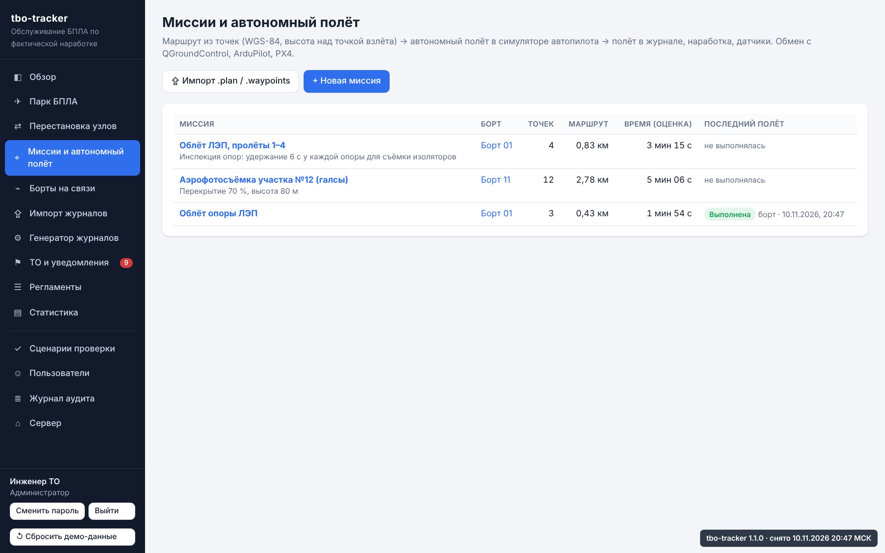
      <p><b>«Миссии и автономный полёт»</b> – маршруты бортов, оценка времени, обмен с QGroundControl, ArduPilot, PX4</p>
    </td>
    <td width="50%" valign="top">
      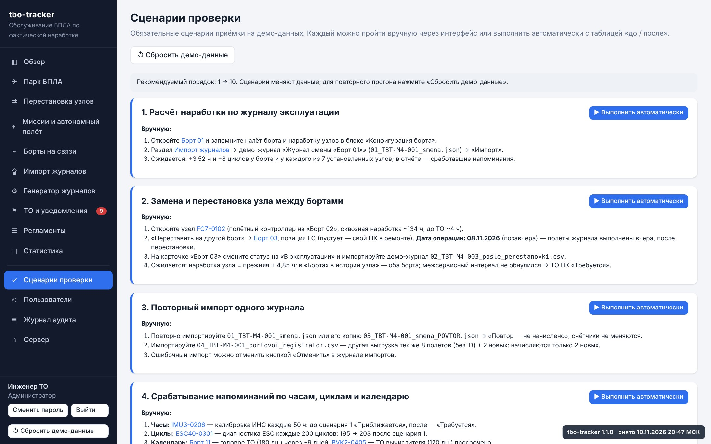
      <p><b>«Сценарии проверки»</b> – 10 сценариев приёмки: вручную или кнопкой «Выполнить автоматически»</p>
    </td>
  </tr>
  <tr>
    <td width="50%" valign="top">
      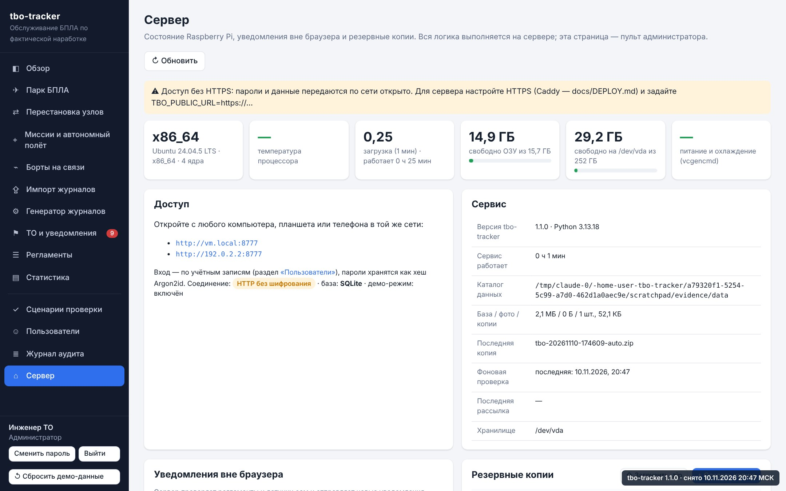
      <p><b>«Сервер»</b> – состояние Raspberry Pi, адреса для входа, уведомления вне браузера, резервные копии</p>
    </td>
    <td width="50%" valign="top">
      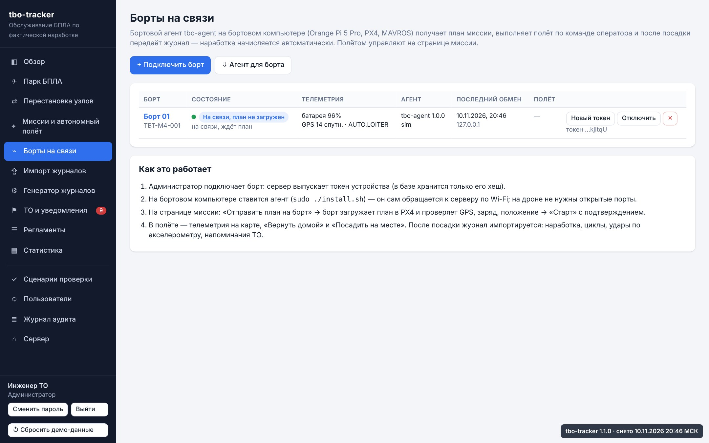
      <p><b>«Борты на связи»</b> – бортовой агент на связи: батарея, GPS, режим PX4, версия агента</p>
    </td>
  </tr>
</table>

Все экранные формы – в [docs/img/screens/](docs/img/screens/).

## Быстрый старт

### Требования и зависимости

| Где | Что нужно |
|---|---|
| Windows, Linux, macOS | Python 3.11 или новее |
| Docker | Docker Engine 24+ с плагином `docker compose` или Docker Desktop |
| Raspberry Pi | Raspberry Pi 5 (4–8 ГБ), Raspberry Pi OS Lite (64-bit) |
| Борт | Skyris Technic 6S: Orange Pi 5 Pro с образом Technic (ROS Noetic, MAVROS), PX4 |

Зависимости сервера: [`requirements.txt`](requirements.txt) – диапазоны версий для `run.bat`, `run.sh` и разработки;
[`requirements.lock`](requirements.lock) – точные версии, их ставят Dockerfile и установщик Raspberry Pi;
[`requirements-dev.txt`](requirements-dev.txt) – плюс pytest и httpx для автотестов.
Бортовой агент обходится стандартной библиотекой Python 3.8+.

| Платформа | Запуск | Подробно |
|---|---|---|
| Windows 10 / 11 | двойной щелчок по `run.bat` | [ниже](#windows-10--11) |
| Linux / macOS | `./run.sh` | [ниже](#linux--macos) |
| Сервер в Docker | `docker compose … up -d --build` | [ниже](#docker), [DEPLOY.md](docs/DEPLOY.md) |
| Raspberry Pi 5 | `sudo ./deploy/raspberry-pi/install.sh --https` | [ниже](#raspberry-pi-5), [RASPBERRY_PI.md](docs/RASPBERRY_PI.md) |
| Сервер и дрон | `./deploy/field/deploy.sh --server … --drone …` | [ниже](#сервер-и-дрон-одной-командой), [DRONE.md](docs/DRONE.md) |

`run.bat` и `run.sh` предназначены для разработки и демонстрации: запускают сервер в [демо-режиме](#после-запуска)
на <http://localhost:8000>.

### Windows 10 / 11

1. Установите **Python 3.11 или новее** с <https://www.python.org/downloads/>.
   В первом окне установщика отметьте **«Add python.exe to PATH»**.
2. Скачайте проект: на странице репозитория **Code → Download ZIP**, распакуйте архив (например, в `C:\tbo-tracker`).
   Или, если установлен Git:
   ```powershell
   git clone https://github.com/DanilTeplo/tbo-tracker.git
   ```
3. Дважды щёлкните **`run.bat`** в папке проекта. При первом запуске он создаст окружение `.venv`
   и установит зависимости (1–2 минуты, нужен интернет), затем откроет браузер на <http://localhost:8000>.
4. Остановить сервер – **Ctrl+C** в окне консоли или просто закрыть окно.

Если браузер открылся раньше, чем запустился сервер, обновите страницу через пару секунд.
Другой порт: в консоли `set PORT=8080`, затем `run.bat`.

<details>
<summary><b>Вручную в PowerShell</b></summary>

```powershell
cd C:\tbo-tracker
```

```powershell
py -m venv .venv
```

```powershell
.venv\Scripts\python -m pip install -r requirements.txt
```

```powershell
.venv\Scripts\python -m uvicorn app.main:app --port 8000
```

Команды вызывают `.venv\Scripts\python` напрямую – активировать окружение не нужно, поэтому политика выполнения
скриптов PowerShell не мешает. Если команда `py` не найдена, используйте `python`.

</details>

<details>
<summary><b>Частые проблемы на Windows</b></summary>

| Симптом | Решение |
|---|---|
| `Python не найден` / `'py' is not recognized` | Переустановите Python с галочкой «Add python.exe to PATH» или используйте `python` вместо `py` |
| `Address already in use` / порт занят | `set PORT=8080` и снова `run.bat`, затем откройте <http://localhost:8080> |
| Где взять код настройки | Он напечатан в окне `run.bat` («Одноразовый код настройки») и записан в `data\setup-code.txt` |
| Нужны чистые демо-данные | Кнопка «Сбросить демо-данные» в интерфейсе (учётные записи сохранятся) или удалить папку `data` |
| Кракозябры в консоли | `run.bat` переключает консоль в UTF-8; в старых консолях используйте Windows Terminal |

</details>

### Linux / macOS

```bash
git clone https://github.com/DanilTeplo/tbo-tracker.git && cd tbo-tracker
```

```bash
./run.sh
```

`run.sh` создаёт окружение `.venv`, ставит зависимости и запускает сервер на <http://localhost:8000>;
другой порт – `PORT=8080 ./run.sh`. На Debian и Ubuntu для окружения может понадобиться пакет `python3-venv`.

<details>
<summary><b>Вручную</b></summary>

```bash
python3 -m venv .venv && . .venv/bin/activate
```

```bash
pip install -r requirements.txt
```

```bash
TBO_DEMO_MODE=1 python -m app.serve
```

</details>

### Docker

**Проба на одном компьютере** (SQLite, доступ только с этого компьютера; подходит и Docker Desktop на Windows и macOS):

```bash
docker compose up -d --build
```

Откройте <http://localhost:8000>. Одноразовый код настройки для первого входа – в журнале контейнера:

```bash
docker compose logs app | grep -A1 "код настройки"
```

Демо-данные и сценарии проверки включаются строкой `TBO_DEMO_MODE=1` в файле `.env`.

**Рабочий сервер** – PostgreSQL и HTTPS через Caddy (рекомендуется):

```bash
sh deploy/docker/init.sh
```

Сценарий создаёт `.env` из `.env.example` и случайный пароль PostgreSQL в `secrets/`. Задайте в `.env` домен
`TBO_DOMAIN` и способ выпуска сертификата `TBO_TLS`: `acme` – Let's Encrypt, `internal` – для локальной сети. Затем:

```bash
docker compose -f compose.yaml -f compose.postgres.yaml -f compose.https.yaml up -d --build
```

Откройте `https://<домен>` и создайте первого администратора по одноразовому коду настройки из журнала:

```bash
docker compose -f compose.yaml -f compose.postgres.yaml -f compose.https.yaml logs app | grep -A1 "код настройки"
```

Варианты с SQLite и без HTTPS, администрирование, перенос данных, переменные окружения – [DEPLOY.md](docs/DEPLOY.md).

### Raspberry Pi 5

Постоянный сервер для локальной сети: все пользователи открывают `https://tbo-tracker.local` в браузере на компьютере,
планшете или телефоне. Вся логика – расчёт ресурса, регламенты, уведомления с рассылкой в Telegram и на webhook,
перестановки узлов, сценарии, резервные копии – выполняется на Raspberry Pi, браузер только отображает.

Запишите **Raspberry Pi OS Lite (64-bit)** программой Raspberry Pi Imager: имя хоста `tbo-tracker`, включённый SSH.
Затем на Pi:

```bash
sudo apt update && sudo apt install -y git
```

```bash
git clone https://github.com/DanilTeplo/tbo-tracker.git && cd tbo-tracker
```

```bash
sudo ./deploy/raspberry-pi/install.sh --https
```

Установщик (3–5 минут) создаёт службу systemd с автозапуском, спрашивает пароль администратора (скрытый ввод),
настраивает HTTPS и ежедневные резервные копии. Параметры: `--demo` – демо-данные и сценарии проверки,
`--port 8080` – порт без HTTPS, `--admin ИМЯ` – имя первого администратора.
Дальше – страница **«Сервер»** в веб-интерфейсе (состояние Pi, уведомления, копии) и утилита `sudo tbo-ctl` по SSH.
Выбор оборудования, установка без интернета и неполадки – [RASPBERRY_PI.md](docs/RASPBERRY_PI.md).

### Сервер и дрон одной командой

С компьютера в той же сети, что и обе платы, ставятся сервер на Raspberry Pi и бортовой агент на Orange Pi дрона,
а борт подключается к серверу:

```bash
./deploy/field/deploy.sh --server user@192.168.50.10 --drone orangepi@10.255.37.62
```

Пароли плат вводятся только в запросы `ssh` и `sudo`, токен устройства передаётся на борт без вывода на экран.
Работает в Linux, macOS и Windows (WSL, Git Bash). Подробно – [DRONE.md](docs/DRONE.md), раздел 1а.

## После запуска

> [!IMPORTANT]
> Паролей по умолчанию нет. При первом запуске пустой базы сервер печатает **одноразовый код настройки**.

1. Найдите в консоли строку «Одноразовый код настройки». Код также записан в `data/setup-code.txt`; в Docker он
   в журнале контейнера, на Raspberry Pi – `sudo tbo-ctl setup-code` (обычно администратора создаёт сам установщик).
2. Откройте <http://localhost:8000>, введите код и создайте администратора.
3. Учётные записи коллег добавьте в разделе «Пользователи»: роли – администратор, инженер, наблюдатель.

**Демо-режим.** `run.bat` и `run.sh` заполняют базу (SQLite, `data/tbo.db`) случайно сгенерированными демо-данными:
5 бортов двух типов, 44 узла, около 1 400 полётов за 5–7 месяцев, 11 регламентов, история перестановок и ремонтов,
2 миссии и 10 журналов для сценариев проверки в `data/demo_logs/`. Даты строятся от момента заполнения, поэтому
календарные напоминания работают в любой день. Пересоздать демо-данные – кнопка «Сбросить демо-данные», учётные
записи сохраняются.

**Сценарии проверки.** Раздел «Сценарии проверки» – 10 сценариев приёмки на сгенерированных демо-данных, каждый
проходится вручную или кнопкой «Выполнить автоматически» с таблицей «до / после»:

<table>
  <tr>
    <td width="50%" valign="top">
      <ol>
        <li>Расчёт наработки по журналу эксплуатации</li>
        <li>Замена и перестановка узла между бортами</li>
        <li>Повторный импорт одного журнала</li>
        <li>Срабатывание напоминаний по часам, циклам и календарю</li>
        <li>Проведение обслуживания по напоминанию</li>
      </ol>
    </td>
    <td width="50%" valign="top">
      <ol start="6">
        <li>Автономный полёт по заданному маршруту</li>
        <li>Падение по данным датчиков и запрет вылета</li>
        <li>Журнал установок, снятий и перестановок из Excel и PDF</li>
        <li>Перестановка узла между карточками бортов</li>
        <li>Автоматические уведомления</li>
      </ol>
    </td>
  </tr>
</table>

Ручной путь – [SCENARIOS.md](docs/SCENARIOS.md), пошаговая проверка всех функций – [TESTING.md](docs/TESTING.md).

**Смена инженера** ([руководство](docs/USER_GUIDE.md)):

1. Перед сменой – «Обзор»: борт с красной меткой «Не допущен» не выпускать, причина указана в карточке борта.
2. После смены – журналы наземной станции в «Импорт журналов»: отчёт покажет начисленные часы и циклы каждому борту
   и узлу и наступившие сроки ТО.
3. При замене или перестановке узла – перетащить его в «Перестановке узлов»: наработка и история останутся за узлом.
4. По уведомлению – выполнить работу и отметить её в «ТО и уведомления» → «Выполнить».

**REST API** с документацией (Swagger) включается переменной `TBO_API_DOCS=1` и доступен только администратору:
<http://localhost:8000/docs>.

**Генератор журналов** из командной строки:

```bash
python -m app.loggen --aircraft TBT-M4-001 TBT-VT2-011 --days 3 --format csv -o my_log.csv
```

```bash
python -m app.loggen --aircraft TBT-M4-002 --days 2 --import
```

Все параметры – `python -m app.loggen --help` (на Windows – `.venv\Scripts\python -m app.loggen --help`),
формат журналов – [LOG_FORMAT.md](docs/LOG_FORMAT.md).

## Полёт на реальном борту

Бортовой агент [`tbo-agent`](agent/) работает на бортовом компьютере Skyris Technic 6S (Orange Pi 5 Pro, ROS Noetic,
MAVROS, PX4). Он сам обращается к серверу по Wi-Fi по токену устройства – входящие порты на дроне не нужны.
Полётом управляет PX4, **пульт пилота главнее автопилота**.

<table>
  <tr>
    <td width="33%" valign="top">
      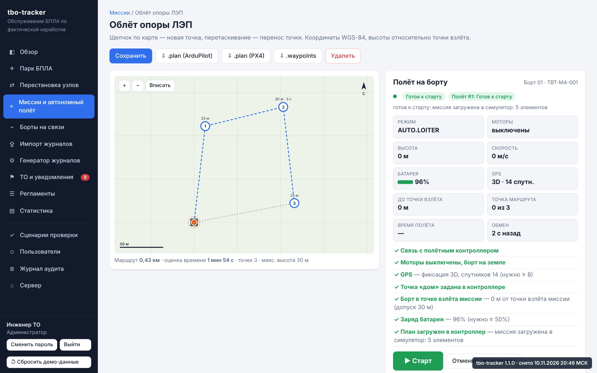
      <p><b>1. «Готов к старту»</b> – план загружен на борт, проверки борта пройдены</p>
    </td>
    <td width="33%" valign="top">
      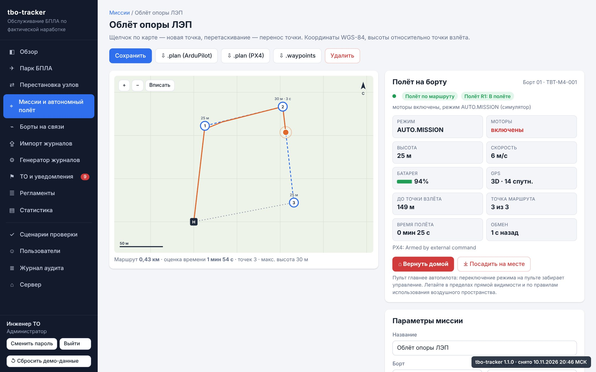
      <p><b>2. Полёт</b> – положение и трек на карте, телеметрия PX4, «Вернуть домой» и «Посадить»</p>
    </td>
    <td width="33%" valign="top">
      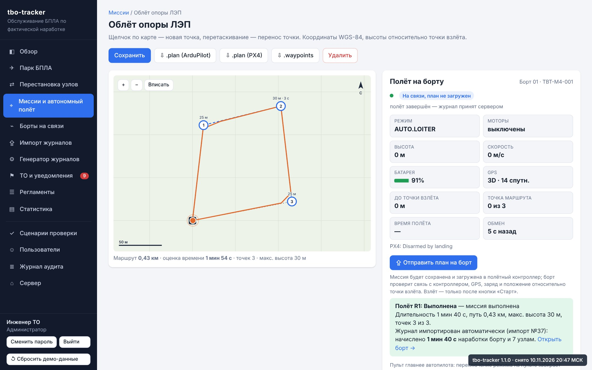
      <p><b>3. После посадки</b> – журнал импортирован автоматически, наработка начислена борту и узлам</p>
    </td>
  </tr>
</table>

<sub>Экраны сняты в режиме симулятора борта на сгенерированных данных: работает тот же агент, вместо ROS и PX4 – их модель.</sub>

1. **Подключение.** «Борты на связи» → «+ Подключить борт» → токен устройства (показывается один раз)
   и «Агент для борта»; на борту – `sudo ./install.sh`. Или всё [одной командой](#сервер-и-дрон-одной-командой).
2. **Подготовка.** На странице миссии – «Отправить план на борт». Сервер проверяет допуск по ТО и пределы полёта,
   агент – хеш плана, связь с PX4, моторы, GPS, точку «дом», положение в точке взлёта и заряд. План загружается в PX4
   и сверяется обратным чтением → «Готов к старту».
3. **Полёт.** «Старт» с подтверждением оператора, команда действует 15 с. На карте – положение и трек борта,
   в панели – телеметрия PX4; «Вернуть домой», «Посадить на месте», видео с борта.
4. **После посадки** агент передаёт журнал – трек 1 Гц, акселерометр 25 Гц, режимы, события. Сервер импортирует
   его сам: наработка и циклы, удары по акселерометру, напоминания ТО. Пропала связь – журнал хранится на борту
   и передаётся повторно каждые 30 с.

Миссии – по GPS и локальные, в помещении: Optical Flow с дальномером VL53L1X или ArUco, до 3 м высоты, 20 м удаления
и 2 м/с. Курс дрона задаётся «по линии маршрута» или в точках.

Проверка без дрона – симулятор агента:

```bash
cd agent && python3 -m tbo_agent --config agent.conf --sim --sim-speed 10
```

> [!NOTE]
> Реальные испытания – около 50 запусков на одном дроне. Кроме того, агент проверен на модели PX4 / MAVROS /
> simple_offboard, в том числе с заводскими параметрами Technic, на собственном симуляторе и под Python 3.8,
> как в ROS Noetic; в симуляторе Gazebo полёты не выполнялись. Перед эксплуатацией нужны наземные проверки
> и пробные полёты по [чек-листу запуска](docs/LAUNCH_CHECKLIST.md). Подробно – [DRONE.md](docs/DRONE.md).

## Как устроено

<p align="center">
  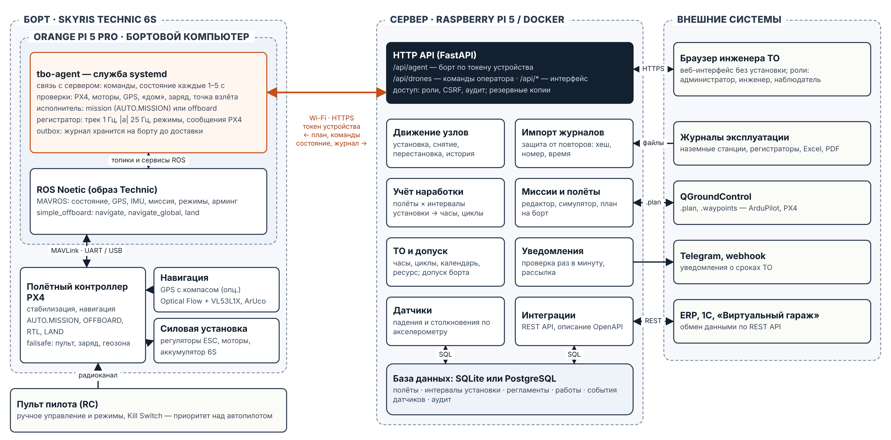
  <br>
  <sub>Структурная (функциональная) схема: борт Skyris Technic 6S, сервер и внешние системы</sub>
</p>

**Наработка вычисляется, а не хранится.** Её не хранит счётчик, который можно испортить: она выводится из двух
журналов, в которые только добавляются записи, – полётов и интервалов установки узлов
(«узел X стоял на борту Y в позиции P с … по …»):

```text
наработка_узла = начальная_наработка
               + Σ полётов f, для которых есть интервал установки i:
                   f.борт = i.борт и i.установлен ≤ f.взлёт < i.снят (или i.снят пуст)
```

Отсюда главные свойства учёта:

- при перестановке часы остаются за узлом и продолжают расти на новом борту;
- журнал, загруженный после перестановки, начисляется составу борта на момент взлёта;
- отмена ошибочного импорта и операции задним числом пересчитывают все счётчики сами;
- одна смена из разных источников не учитывается дважды: хеш файла, номер полёта, пересечение по времени.

Архитектура, модель данных и правила расчёта – [ARCHITECTURE.md](docs/ARCHITECTURE.md).

**Две конфигурации подключения к БАС** ([INTEGRATION.md](docs/INTEGRATION.md)):

| | Борт на связи | Через наземную станцию |
|---|---|---|
| Борт | Skyris Technic 6S: Orange Pi 5 Pro + PX4 | любой борт на ArduPilot или PX4 |
| Задание на борт | «Полёт на борту» → агент → MAVROS → PX4 | экспорт `.plan` / `.waypoints` → QGroundControl |
| Данные обратно | агент сам отправляет журнал после посадки | журнал наземной станции, Excel или PDF → «Импорт журналов» |
| Навигация | GPS или локальная (Optical Flow + VL53L1X, ArUco) | GPS |

Обе конфигурации дают один результат: наработка начисляется борту и установленным узлам, акселерометр проверяется
на падения и столкновения, срабатывают напоминания ТО.

<details>
<summary><b>Алгоритм работы и обработка отказов</b></summary>
<br>
<p align="center">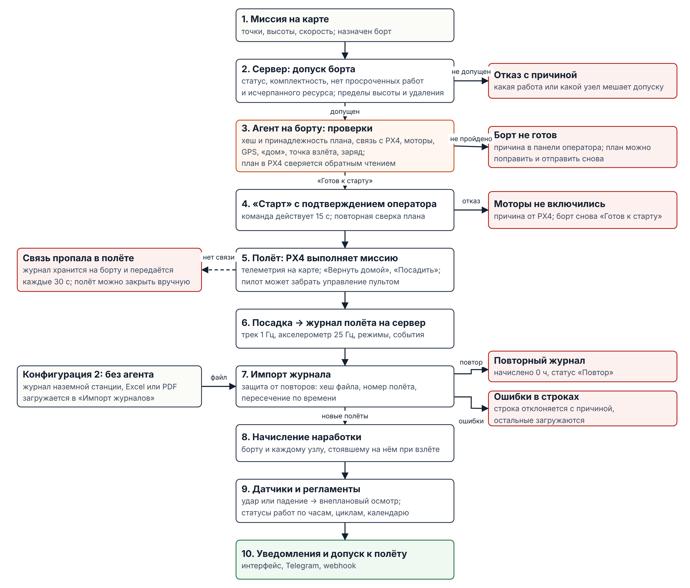</p>
</details>

<details>
<summary><b>Схема подключения оборудования</b></summary>
<br>
<p align="center">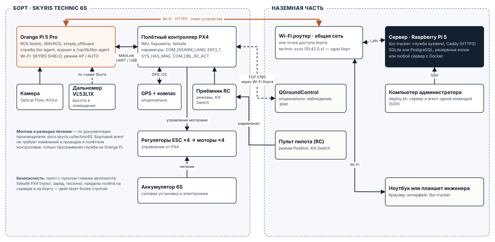</p>
</details>

## Испытания

Реальные испытания – около 50 запусков на одном дроне. Характеристики Х1–Х7 ниже измерены на случайно
сгенерированных данных: модель парка, синтетические записи акселерометра, случайные миссии в симуляторе.
Методика – [программа и методика испытаний](docs/TEST_METHODOLOGY.md), протокол
[№ 2026-11-09](docs/protocols/protocol-2026-11-09.md) на версии `7c0c48b`:

| № | Характеристика | Порог | Результат | Вывод |
|:-:|---|:-:|:-:|:-:|
| Х1 | Отклонение наработки узла от эталона | ≤ 0,01 ч | **0,0033 ч** | соответствует |
| Х2 | Потеря наработки узлов при перестановках между бортами | 0 сверх округления 0,01 ч | **0,0033 ч** | соответствует |
| Х3 | Расхождения статуса ТО с эталоном | 0 | **0 из 950** | соответствует |
| Х4 | Обнаружение падений и столкновений на синтетических записях | ≥ 95 % | **100 %** | соответствует |
| Х5 | Ложные срабатывания детектора на синтетических записях | ≤ 2 % | **0 %** | соответствует |
| Х6 | Отклонение от линии пути в симуляторе при ветре до 8 м/с | ≤ 10 м | **8,31 м** | соответствует |
| Х7 | Импорт журнала сгенерированного парка за 90 дней (≈ 1 150 полётов) | ≤ 10 с | **2,91 с** | соответствует |

Все 10 требований кейса подтверждены автотестами того же протокола, тоже на сгенерированных данных.

Автоматический протокол – характеристики Х1–Х7 и требования кейса, результат в `docs/protocols/`:

```bash
python scripts/run_acceptance.py
```

Сравнение с учётом по формуляру борта на случайно сгенерированной модели парка:

```bash
python scripts/benchmark_vs_logbook.py
```

### Автотесты

```bash
pip install -r requirements-dev.txt
```

**Сервер** – 134 автотеста: сценарии приёмки, правила целостности, ручной ввод, внебортовая наработка, справочники
типов, генератор журналов, паспорта, датчики, Excel и PDF, миссии, уведомления, перестановка узлов, серверная часть
(рассылка, резервные копии, состояние сервера), связь с бортами по HTTP и безопасность (вход, сессии, CSRF, роли,
перебор паролей, аудит, заголовки):

```bash
python -m pytest -q tests
```

**Бортовой агент** – 48 автотестов: модель PX4 / MAVROS, заводские параметры Technic, локальные миссии, симулятор;
проходят и под Python 3.8, как на борту:

```bash
python -m pytest -q agent/agent_tests
```

На Windows – те же команды через `.venv\Scripts\python`, например `.venv\Scripts\python -m pytest -q tests`.
Набор сервера проходит и на PostgreSQL: `TBO_TEST_DATABASE_URL=postgresql+psycopg://… python -m pytest -q tests`.

## Безопасность

- **Вход** только по учётным записям, паролей по умолчанию нет. Пароли хранятся как хеш **Argon2id**.
- **Сессии** – cookie HttpOnly / SameSite=Strict, при HTTPS ещё и Secure; ограничения по бездействию и сроку.
- **Запросы** – CSRF-токен и проверка Origin, роли на каждом запросе, блокировка перебора паролей.
- **Журнал аудита** – входы и все изменения данных.
- **Браузер** – строгая CSP без встроенных скриптов и стилей, заголовки безопасности.
- **Развёртывание** – контейнер без root с файловой системой только для чтения, пароль БД – Docker secret, HTTPS через Caddy;
  служба на Raspberry Pi без прав root, с ограничениями systemd.
- **Связь с бортом** – токен устройства 256 бит, на сервере хранится только хеш; агент видит только свой борт;
  пределы высоты и удаления проверяют и сервер, и борт, действует более строгий.

Подробно – [SECURITY.md](docs/SECURITY.md); безопасность полёта и обслуживаемость борта – [SAFETY.md](docs/SAFETY.md).

## Документация

| Раздел | Документы |
|---|---|
| Паспорт проекта | [PDF](docs/passport/tbo-tracker-passport.pdf) · [DOCX](docs/passport/tbo-tracker-passport.docx) · [кратко](docs/PASSPORT.md) |
| Работа с системой | [Руководство инженера](docs/USER_GUIDE.md) · [Демо-данные и сценарии приёмки](docs/SCENARIOS.md) · [Формат журналов](docs/LOG_FORMAT.md) |
| Развёртывание | [Docker, PostgreSQL, HTTPS](docs/DEPLOY.md) · [Raspberry Pi 5](docs/RASPBERRY_PI.md) · [Полёт на реальном борту](docs/DRONE.md) · [Бортовой агент](agent/README.md) |
| Устройство | [Архитектура](docs/ARCHITECTURE.md) · [Интеграция с БАС](docs/INTEGRATION.md) · [Безопасность](docs/SECURITY.md) · [Безопасность и обслуживаемость](docs/SAFETY.md) |
| Испытания | [Соответствие критериям](docs/CRITERIA.md) · [Методика испытаний](docs/TEST_METHODOLOGY.md) · [Протоколы](docs/protocols/) · [Чек-лист запуска](docs/LAUNCH_CHECKLIST.md) · [Проверка всех функций](docs/TESTING.md) |
| Обоснование | [Актуальность и аналоги](docs/MARKET.md) · [Экономика](docs/ECONOMICS.md) |
| Материалы | [Схемы](docs/img/schemes/) · [Экранные формы](docs/img/screens/) · [Промо-ролик, 15 с](promo/tbo-tracker-launch.mp4) |

## Структура репозитория

```text
tbo-tracker/
├── app/                     сервер: FastAPI, бизнес-логика, веб-интерфейс
│   ├── api/                 HTTP API: интерфейс, оператор, бортовой агент, сервер
│   ├── services/            наработка, импорт, ТО, датчики, миссии, борты, уведомления
│   └── static/              интерфейс: HTML, CSS, JavaScript без сборки
├── agent/                   бортовой агент tbo-agent и его автотесты
├── deploy/
│   ├── docker/              Caddy (HTTPS), init.sh – .env и пароль базы
│   ├── raspberry-pi/        установщик, tbo-ctl, служба systemd, Wi-Fi, установка без интернета
│   └── field/               deploy.sh – сервер и агент одной командой
├── docs/                    документация, паспорт проекта, схемы, экранные формы, протоколы
├── scripts/                 протокол испытаний, замер против формуляра, экономика, MAVLink
├── tests/                   автотесты сервера
├── promo/                   промо-ролик и его исходники
├── Dockerfile               образ сервера (amd64 и arm64)
├── compose*.yaml            Docker Compose: SQLite, PostgreSQL, HTTPS
├── .env.example             образец настроек сервера в Docker
├── run.bat, run.sh          запуск для разработки и демонстрации
├── requirements.txt         зависимости сервера, диапазоны версий
├── requirements.lock        точные версии для развёртывания
├── requirements-dev.txt     плюс pytest и httpx для автотестов
├── LICENSE                  лицензия MIT
└── THIRD_PARTY_LICENSES.md  лицензии зависимостей
```

## Стек

- **Сервер:** Python 3.11+ · FastAPI, uvicorn · SQLAlchemy 2 · SQLite или PostgreSQL 16 (psycopg 3) ·
  Argon2id (argon2-cffi) · openpyxl, pdfplumber, reportlab – Excel и PDF.
- **Интерфейс:** одностраничное приложение на чистом JavaScript без сборки и внешних CDN – работает в закрытом
  контуре (стили – `app/static/css`, скрипты – `app/static/js`).
- **Бортовой агент:** Python 3.8+, только стандартная библиотека; на борту – ROS Noetic, MAVROS, simple_offboard
  из образа Technic.
- **Развёртывание:** Docker, Caddy (HTTPS), systemd.

## Команда

НИЯУ МИФИ, Москва.

| Участник | Роль | Обязанности |
|---|---|---|
| Тепляков Данил Петрович | руководитель проекта, разработчик | организация работ и взаимодействие с заказчиком; подготовка презентации и защита проекта; веб-интерфейс (`app/static`) и сценарии проверки |
| Острогорский Даниел Тигранович | экономист проекта, разработчик | экономическая модель и расчёт эффективности (`scripts/economics_model.py`); импорт журналов и регламенты ТО (`app/services/logs.py`, `movements.py`, `maintenance.py`) |
| Негоденко Савелий Кириллович | ведущий разработчик | архитектура системы; учёт наработки и API сервера (`app/services/usage.py`, `app/api`); бортовой агент и интеграция с PX4 (`agent/`); автотесты (`tests/`) |

## Лицензия

Код – [MIT](LICENSE). Лицензии зависимостей и сторонних компонентов – [THIRD_PARTY_LICENSES.md](THIRD_PARTY_LICENSES.md):
все допускают использование и распространение в составе проекта.
