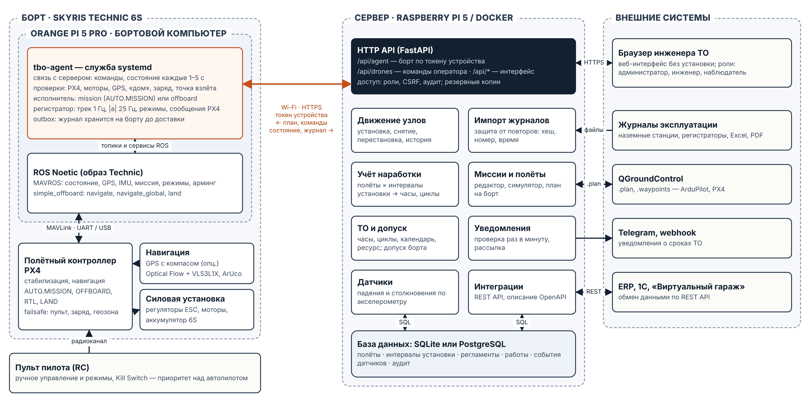

# Паспорт проекта tbo-tracker

Полная версия для сдачи — [passport/tbo-tracker-passport.pdf](passport/tbo-tracker-passport.pdf) ([DOCX](passport/tbo-tracker-passport.docx)).
Этот файл — краткая версия, разделы совпадают.

| | |
|---|---|
| Кейс | «Обслуживание БПЛА по фактической наработке», чемпионат «Хайтек: навыки будущего» 2026, компетенция «Летающая робототехника» |
| Команда | [название команды], [город] |
| Назначение | Поэкземплярный учёт наработки БПЛА и заменяемых узлов, контроль ресурса и сроков ТО по фактическим полётам |
| Пользователи | инженер по ТО эксплуатанта (5–50 бортов), сервисный центр, служба эксплуатации предприятия |
| Состав | сервер tbo-tracker (Raspberry Pi 5 или Docker), веб-интерфейс, бортовой агент для Skyris Technic 6S (Orange Pi 5 Pro + PX4) |

## 1. Краткое техническое описание

### 1.1 Цель

Исключить пропуски ТО и потерю наработки узлов при их перестановке между бортами. Для этого наработка ведётся по каждому экземпляру узла, автоматически по журналам полётов.

**Проблема.** Формуляр ведётся по борту. Когда узел переставляют, часы, наработанные им на другом борту, в формуляр не попадают. Замер на модели парка из 6 бортов за 90 дней показал: при учёте по формуляру теряется около 1 700 ч наработки узлов, а около 6 просроченных работ не видны. Протокол — [protocols/](protocols/).

### 1.2 Основные характеристики

| Характеристика | Значение |
|---|---|
| Объекты учёта | борта, заменяемые узлы (свои типы узлов и посадочных мест), склад и ремонт |
| Источники данных | бортовой агент (журнал полёта автоматически); журналы наземных станций JSON и CSV; Excel и PDF — полёты и движение узлов |
| Учёт | часы налёта и циклы борта и каждого узла; остаточный ресурс; история установок |
| ТО | регламенты по часам, циклам, календарю и событиям датчиков; назначенный ресурс; допуск борта |
| Связь с бортом | план на борт, проверки, «Старт», телеметрия на карте, «Вернуть домой», «Посадить»; PX4 через MAVROS |
| Развёртывание | Raspberry Pi 5 или Docker; работает без интернета |

Измеряемые характеристики (методика — [TEST_METHODOLOGY.md](TEST_METHODOLOGY.md)):

| № | Характеристика | Порог | Результат |
|---|---|---|---|
| Х1 | Отклонение наработки узла от эталона | ≤ 0,01 ч | 0,0033 ч |
| Х2 | Потеря наработки при перестановках | 0 | 0 (в пределах округления 0,01 ч) |
| Х3 | Расхождения статуса ТО с эталоном | 0 | 0 из 950 |
| Х4 | Обнаружение падений и столкновений | ≥ 95 % | 100 % (200 событий) |
| Х5 | Ложные срабатывания детектора | ≤ 2 % | 0 % (100 полётов) |
| Х6 | Отклонение от линии маршрута (симулятор, ветер до 8 м/с) | ≤ 10 м | 8,31 м |
| Х7 | Импорт журнала парка за 90 дней (≈ 1 150 полётов) | ≤ 10 с | 2,91 с |

### 1.3 Структурная (функциональная) схема

| Модуль | Что делает | Требования кейса |
|---|---|---|
| Паспорта и конфигурация | паспорта бортов и узлов, посадочные места, склад, перестановка перетаскиванием | 2, 6, 8, 10 |
| Учёт наработки | импорт журналов, защита от двойного учёта, часы и циклы | 4, 5, 6 |
| ТО и уведомления | регламенты, ресурс, допуск борта, Telegram и webhook | 7 |
| Мониторинг датчиков | падения и столкновения по акселерометру, внеплановый осмотр | 3 |
| Миссии | маршрут на карте (GPS и локальный), симулятор, `.plan` для QGroundControl | 1 |
| Бортовой агент | связь борта с сервером, исполнение плана, журнал полёта | 1, 3, 4 |

Алгоритм работы — [img/schemes/algorithm.png](img/schemes/algorithm.png). Архитектура подробно — [ARCHITECTURE.md](ARCHITECTURE.md).

### 1.4 Обоснование ключевых инженерных решений

| Решение | Почему | Подтверждение |
|---|---|---|
| Наработка вычисляется из двух журналов, в которые только добавляются записи: полёты и интервалы установки ([схема](img/schemes/usage-principle.png)) | часы идут за узлом при любой перестановке; поздний журнал, отмена импорта и операция задним числом пересчитываются сами | замер: 10 прогонов, ≈ 11 600 полётов, отклонение ≤ 0,0033 ч; `test_late_import_uses_historical_configuration` |
| Защита от повторов на трёх уровнях: хеш файла, номер полёта, пересечение по времени | одна смена приходит из разных источников; повтор не должен начислять часы | `test_3_reimport_does_not_double_count`; повтор = 0 ч |
| Бортовой агент сам подключается к серверу по токену устройства | на дроне не нужны входящие порты; работает через роутер и через точку доступа борта | `tests/test_drones.py`: настоящий сервер и агент по HTTP |
| Полётом управляет PX4, агент загружает план и наблюдает; пилот главнее | при сбое бортового компьютера полёт продолжает PX4, пилот может забрать управление | `agent/agent_tests`; [DRONE.md](DRONE.md), раздел 4 |
| План проверяется хешем и обратным чтением из PX4 | борт не полетит по изменённому или чужому плану | `agent/agent_tests` |
| Детектор падений: невесомость < 0,35 g от 0,2 с и удар ≥ 3 g; столкновение — удар ≥ 4 g; касание при посадке не считается | после удара нужен осмотр, а ложная тревога ставит борт на прикол | протокол: 300 записей, 100 % обнаружено, 0 ложных |
| Один процесс, SQLite или PostgreSQL, интерфейс без CDN | работает в закрытом контуре и на Raspberry Pi | установка без интернета (`deploy/raspberry-pi/offline`) |

## 2. Распределение ролей в команде

Таблицу заполняет команда. Роли можно совмещать: в команде от 2 до 5 человек.

| ФИО участника | Роль | Обязанности | Вклад в реализацию |
|---|---|---|---|
| [ФИО] | Руководитель проекта, экономист | постановка задачи с заказчиком, план работ, экономическая модель, презентация и защита | `scripts/economics_model.py`, [ECONOMICS.md](ECONOMICS.md), презентация |
| [ФИО] | Разработчик серверной части | учёт наработки, импорт журналов, регламенты ТО, API, безопасность | `app/services/usage.py`, `logs.py`, `movements.py`, `maintenance.py`, `app/api` |
| [ФИО] | Разработчик интерфейса | веб-интерфейс: паспорта, перестановка узлов, миссии, панель полёта | `app/static` |
| [ФИО] | Инженер БАС | бортовой агент, интеграция с PX4 и MAVROS, подготовка борта, полёты, безопасность борта | `agent/`, [DRONE.md](DRONE.md) |
| [ФИО] | Инженер по испытаниям | методика и протоколы, автотесты, чек-лист запуска, руководство пользователя | `tests/`, `scripts/run_acceptance.py`, [TEST_METHODOLOGY.md](TEST_METHODOLOGY.md) |

## 3. Комплект проектных материалов

### 3.1 Схемы

| Схема | Файл |
|---|---|
| Структурная (функциональная) схема системы | [img/schemes/structure.png](img/schemes/structure.png) |
| Схема подключения оборудования | [img/schemes/wiring.png](img/schemes/wiring.png) |
| Алгоритм работы и обработка отказов | [img/schemes/algorithm.png](img/schemes/algorithm.png) |
| Принцип расчёта наработки узла | [img/schemes/usage-principle.png](img/schemes/usage-principle.png) |

### 3.2 Фотографии и экранные формы прототипа

Экранные формы сняты 10.11.2026 на версии 1.1.0. Полёт через бортовой агент снят в режиме симулятора борта: тот же агент, вместо ROS — модель PX4.

| Экран | Файл |
|---|---|
| Обзор парка, допуск бортов | [01-dashboard.jpg](img/screens/01-dashboard.jpg) |
| Парк БПЛА | [02-fleet.jpg](img/screens/02-fleet.jpg) |
| Карточка борта | [03-aircraft.jpg](img/screens/03-aircraft.jpg) |
| Электронный паспорт узла | [04-passport.jpg](img/screens/04-passport.jpg) |
| Перестановка узлов перетаскиванием | [05-board.jpg](img/screens/05-board.jpg) |
| Журнал импортов | [06-imports.jpg](img/screens/06-imports.jpg) |
| ТО и уведомления | [07-maintenance.jpg](img/screens/07-maintenance.jpg) |
| Миссии | [08-missions.jpg](img/screens/08-missions.jpg) |
| Сценарии проверки | [09-scenarios.jpg](img/screens/09-scenarios.jpg) |
| Сервер | [10-server.jpg](img/screens/10-server.jpg) |
| Борты на связи | [11-drones-online.jpg](img/screens/11-drones-online.jpg) |
| Миссия: «Готов к старту», проверки борта | [12-mission-ready.jpg](img/screens/12-mission-ready.jpg) |
| Полёт на борту: карта и телеметрия | [13-mission-flight.jpg](img/screens/13-mission-flight.jpg) |
| После посадки: журнал импортирован | [14-mission-done.jpg](img/screens/14-mission-done.jpg) |

Фотографии борта, сборки и испытаний команда добавляет в `docs/img/drone/` с датой съёмки в имени файла.

### 3.3 Перечень компонентов, оборудования и технических решений

| № | Наименование компонента / узла | Назначение в системе | Основные характеристики / параметры | Причина выбора / комментарий |
|---|---|---|---|---|
| 1 | Квадрокоптер Skyris Technic 6S | объект эксплуатации, носитель | полётный контроллер PX4, бортовой компьютер Orange Pi 5 Pro, камера, аккумулятор 6S; навигация в помещении — Optical Flow и дальномер VL53L1X или ArUco, GPS — опционально | открытая программируемая платформа с ROS и MAVROS и документацией производителя ([docs.skyris.ru/technic6S](https://docs.skyris.ru/technic6S/)) |
| 2 | Полётный контроллер PX4 (в составе борта) | стабилизация, навигация, выполнение миссии, failsafe | PX4 Autopilot; режимы AUTO.MISSION, OFFBOARD, RTL, LAND; протокол MAVLink | открытый стандарт, поддерживается QGroundControl и MAVROS; полётом управляет PX4, а не агент |
| 3 | Бортовой компьютер Orange Pi 5 Pro (в составе борта) | ROS, MAVROS, служба tbo-agent | Rockchip RK3588S: 4 × Cortex-A76 до 2,4 ГГц + 4 × Cortex-A55; LPDDR5 4–16 ГБ; Wi-Fi 5 | штатный компьютер Technic, ресурсов хватает с запасом |
| 4 | Пульт пилота | ручное управление, перехват, аварийная остановка | отдельный канал Kill Switch | требование чемпионата; пилот главнее автопилота |
| 5 | Сервер Raspberry Pi 5 | tbo-tracker в поле и в закрытом контуре | Broadcom BCM2712: 4 × Cortex-A76 2,4 ГГц; ОЗУ 4–8 ГБ; Wi-Fi 5, Ethernet | недорогой, мало потребляет, работает без интернета; альтернатива — любой сервер с Docker |
| 6 | Wi-Fi роутер | общая сеть борта, сервера и ноутбука | 2,4 / 5 ГГц | несколько бортов одновременно; без роутера — точка доступа борта, один борт |
| 7 | Ноутбук или планшет инженера | работа в веб-интерфейсе | современный браузер | ничего не устанавливается |
| 8 | Серверное ПО tbo-tracker | учёт наработки, ТО, импорт, миссии, связь с бортом | Python 3.11+, FastAPI 0.162, SQLAlchemy 2.1, uvicorn 0.54 | собственная разработка; выбор инструментов — [ARCHITECTURE.md](ARCHITECTURE.md) |
| 9 | СУБД SQLite или PostgreSQL 16 | паспорта, журналы, регламенты | транзакции, `CHECK`, уникальные индексы | SQLite — без настройки на Raspberry Pi; PostgreSQL — для сервера предприятия |
| 10 | Веб-интерфейс | работа инженера и оператора | HTML, CSS, JavaScript без фреймворков; без CDN; строгая CSP | работает без интернета, сборка не нужна |
| 11 | Бортовой агент tbo-agent | связь борта с сервером, исполнение плана, журнал | Python 3.8+, только стандартная библиотека; служба systemd | ничего не доустанавливается в образ Technic |
| 12 | ROS Noetic, MAVROS, simple_offboard | мост между агентом и PX4 | из образа Technic | штатное ПО борта |
| 13 | Caddy, Docker, systemd | HTTPS и развёртывание | контейнер без root, только чтение; служба с ограничениями | воспроизводимая установка одной командой |
| 14 | pytest | автотесты | 186 тестов: сервер 157, агент 29 | проверка каждого изменения |
| 15 | QGroundControl (опционально) | наблюдение за полётом, обмен `.plan` | ArduPilot и PX4 | стандартная наземная станция |
| 16 | Решение: учёт по интервалам установки | расчёт наработки узла | полёты × интервалы «узел на борту с … по …» | см. 1.4 |
| 17 | Решение: защита от повторов | исключить двойное начисление | хеш файла, номер полёта, пересечение по времени | см. 1.4 |
| 18 | Решение: детектор падений и столкновений | внеплановый осмотр после удара | пороги 0,35 g / 0,2 с, 3 g, 4 g; фильтр касания при посадке | см. 1.4 |

Лицензии сторонних компонентов — [THIRD_PARTY_LICENSES.md](../THIRD_PARTY_LICENSES.md).

## 4. Дополнительные требования модуля A

| № | Требование | Где |
|---|---|---|
| 1 | Актуальность: пользователь, проблема, два и больше независимых подтверждения | [MARKET.md](MARKET.md), разделы 1–2 |
| 2 | Анализ существующих решений: не меньше трёх, источники, ограничения, ответ на них | [MARKET.md](MARKET.md), разделы 3–4 |
| 3 | Архитектура: компоненты, связи, входы и выходы, интерфейсы, последовательность, обработка отказов, 2 плюса и 2 ограничения | [ARCHITECTURE.md](ARCHITECTURE.md), схемы в 3.1 |
| 4 | Выбор инструментов: назначение, требования, совместимость, сравнение с альтернативами | [ARCHITECTURE.md](ARCHITECTURE.md), раздел «Почему эти инструменты»; [THIRD_PARTY_LICENSES.md](../THIRD_PARTY_LICENSES.md) |
| 5 | Интеграция: интерфейсы, форматы, ограничения, две конфигурации, конфигурационные параметры | [INTEGRATION.md](INTEGRATION.md) |
| 6 | Безопасность и обслуживаемость | [SAFETY.md](SAFETY.md) |
| 7 | Готовность прототипа: чек-лист запуска | [LAUNCH_CHECKLIST.md](LAUNCH_CHECKLIST.md) |
| 8 | Репозиторий: доступ, README, лицензия, `.gitignore`, без битых ссылок и секретов, история изменений | [README.md](../README.md), [LICENSE](../LICENSE), [THIRD_PARTY_LICENSES.md](../THIRD_PARTY_LICENSES.md), `.gitignore` |
| 9 | Масштабируемость, инструкция по эксплуатации, инструкция по развёртыванию | [ARCHITECTURE.md](ARCHITECTURE.md), раздел «Масштабирование и развитие»; [USER_GUIDE.md](USER_GUIDE.md); [DEPLOY.md](DEPLOY.md), [RASPBERRY_PI.md](RASPBERRY_PI.md), [DRONE.md](DRONE.md) |
